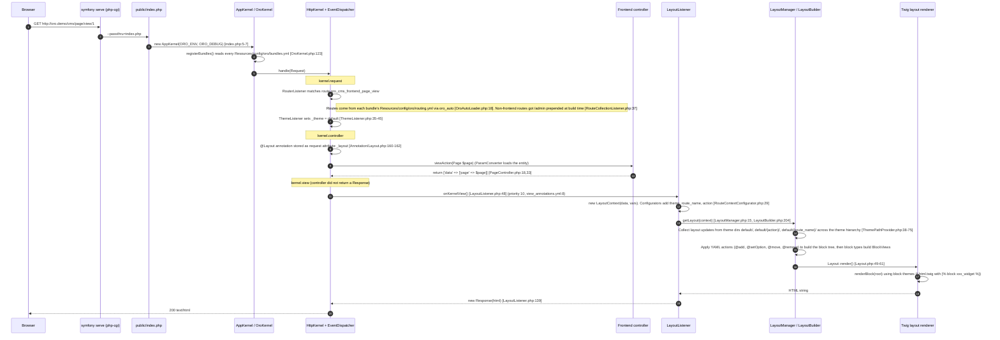
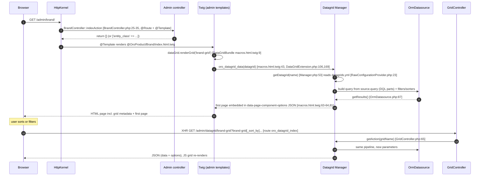
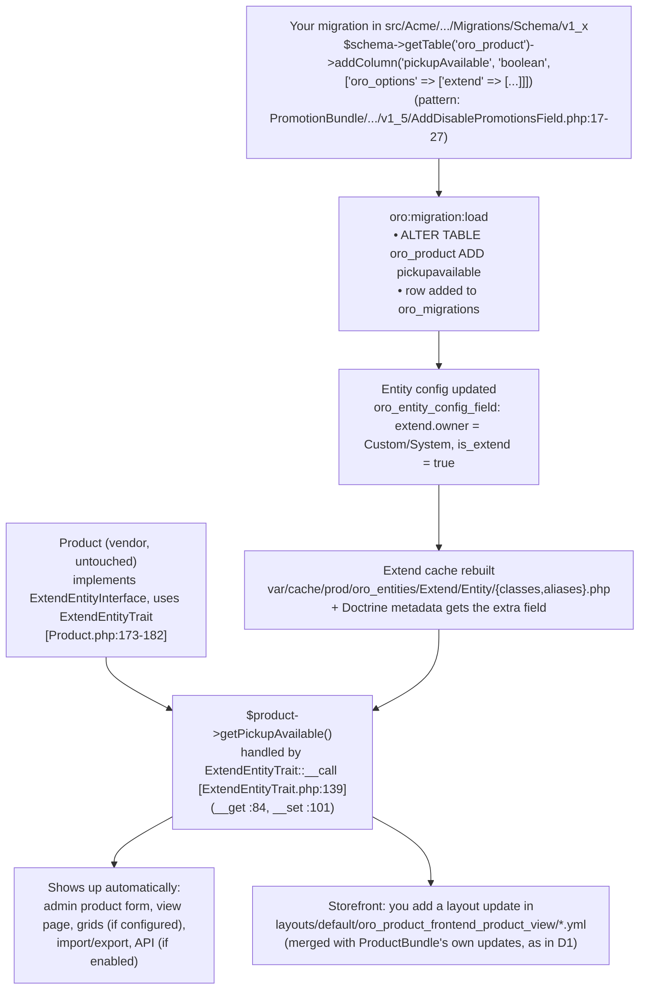

# Request flow traces (Oro 5.1.8)

How a URL becomes HTML in Oro, traced through the real code in `vendor/` (5.1.8). Every file:line below was checked with `grep -n`. Paths are shortened: `platform/` = `vendor/oro/platform/src/Oro/`, `commerce/` = `vendor/oro/commerce/src/Oro/Bundle/`, `portal/` = `vendor/oro/customer-portal/src/Oro/Bundle/`.

Used by spec [`0B-store-locator.md`](../specs/0B-store-locator.md).

---

## D1. Storefront page (e.g. `/cms/page/view/1`, later your `/stores`)



**Key idea:** the storefront controller doesn't render anything. It returns **data**. The *page* is assembled from layout-update YAML files, chosen by **theme + route name**, that any bundle can contribute.

### Magento side by side
| Step | Magento 2 | Oro 5.1 |
|---|---|---|
| Entry | `pub/index.php` → `Bootstrap::run` | `public/index.php` → Symfony Runtime → `AppKernel` |
| Module registration | `registration.php` + `app/etc/config.php` | `Resources/config/oro/bundles.yml` → `OroKernel::registerBundles` |
| Routing | `FrontController` loops routers, `routes.xml` frontName | Symfony `RouterListener`, routes from `routing.yml` + controller annotations. `/admin` prefix added by `RouteCollectionListener` |
| Area / design | area code (`frontend`/`adminhtml`) + design theme | `frontend: true` route option + `_theme` request attribute |
| Controller | `execute()` returns a `ResultPage` | action returns an **array** (with `@Layout`) |
| Layout selection | handles: `default`, `catalog_product_view`, … | dirs: `layouts/default/`, `layouts/default/{route_name}/` |
| Layout language | XML (`<referenceContainer>`, `<block>`) | YAML actions (`@add`, `@setBlockTheme`, `@move`) |
| Rendering | Block classes + `.phtml` | Block types (PHP) + Twig block themes |
| Output | `ResultPage::renderResult` | `Layout::render()` → `Response` |

### How to see it yourself
```bash
docker compose exec php symfony console debug:router oro_cms_frontend_page_view
docker compose exec php symfony console debug:event-dispatcher kernel.view
docker compose exec php symfony console oro:debug:storefront-routes | head          # only frontend: true routes
docker compose exec php symfony console oro:debug:layout:block-types                 # block types usable in layout YAML
docker compose exec php symfony console oro:debug:layout --type=container          # options of one block type
```
**Optional dev mode, with profiler and layout tree.** `public/index.php` reads `ORO_ENV`/`ORO_DEBUG` from env (`index.php:5-6`), so instead of opening up `index_dev.php`, add `ORO_ENV: dev` + `ORO_DEBUG: "1"` to the `php` service env, then `docker compose up -d php` and `cache:clear --env=dev`. *(Not tried yet: the profiler toolbar should then show a "Layout" panel.)*

---

## D2. Admin page + datagrid (e.g. `/admin/brand/`, later your store grid)



**Key idea:** the admin side is "classic Symfony" (controller → Twig). The grid is **configured in YAML, not code**. The first page is server-rendered into the HTML, and every later sort or filter is an XHR to the generic `oro_datagrid_index` route. Magento analogy: a UI-component listing (`*_listing.xml` + `mui/index/render`). The difference is that Oro embeds the first page in the HTML, and there's no data-provider PHP class unless you need one.

### How to see it yourself
- DevTools → Network → sort a column → `datagrid/brand-grid?...` returns JSON.
- View source on `/admin/brand/` and search for `data-page-component-options`: it holds the grid `metadata` + first-page `data` JSON. (5.1.8 has no CLI command that dumps a grid's merged config.)

---

## D3. Extended field lifecycle (your `Product.pickupAvailable`)



**Key idea:** core entities are open for extension through **migrations + entity config**, not by subclassing or editing them. In 5.1 there are **no generated proxy classes for extend fields**. `ExtendEntityTrait` resolves `get*`/`set*` magically against metadata, and only a small class/alias map is cached.
Magento analogy: an EAV attribute added with a Data Patch. The difference is that Oro adds a **real column** to `oro_product` (no EAV value tables), and the field config (`extend`, `form`, `view`, `datagrid`, `dataaudit` scopes) lives in `oro_entity_config_field`.

⚠️ **Upgrade watch:** extend-entity internals are a likely place for 5.1 → 7.0 changes. Check `UPGRADE.md` for `ExtendEntityTrait`/extend changes in Phase 0C.

---

**EE note:** the request flow is the same in EE. Differences appear *inside* the steps: website resolution picks the theme and config per website (multi-website), ACL checks include organization ownership, the datagrid applies org/website scoping, and storefront product data usually comes from **Elasticsearch** (website search) rather than the ORM.
